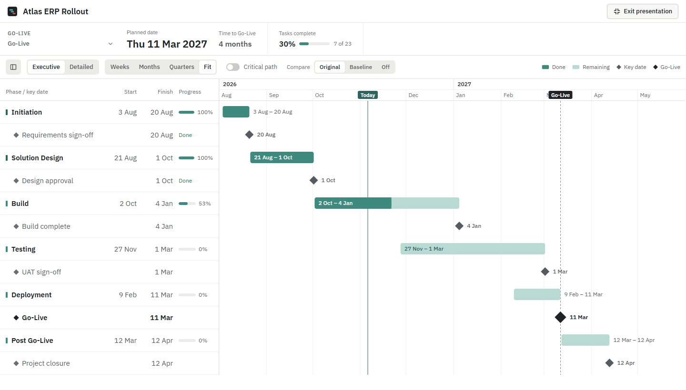
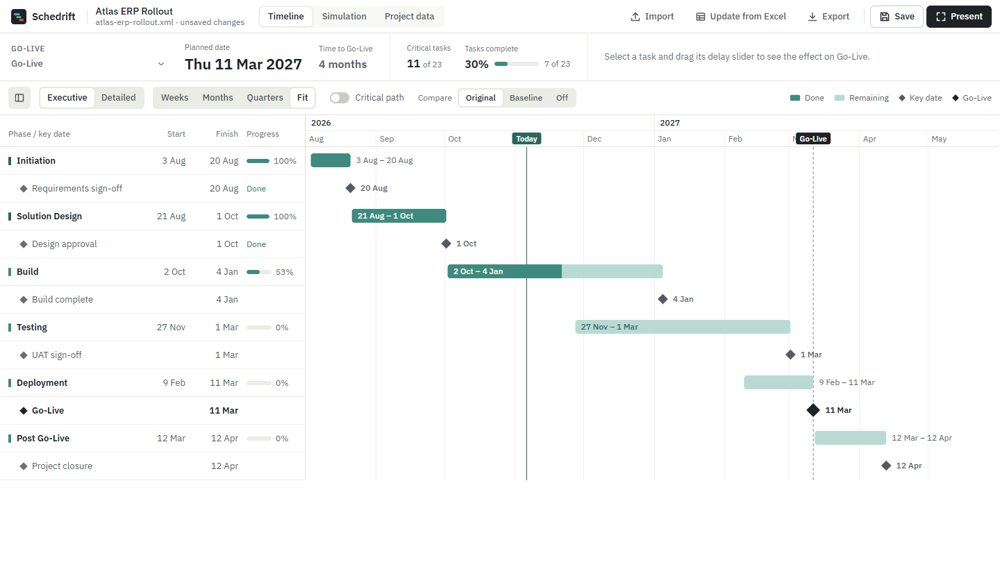
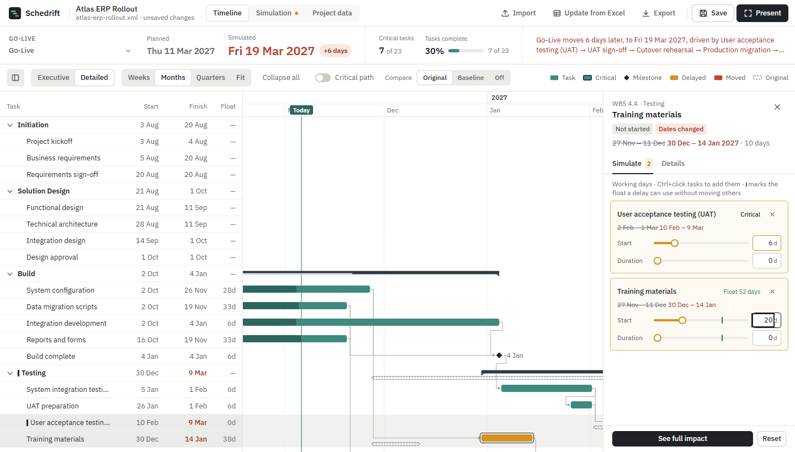

<h1>
  <picture>
    <source media="(prefers-color-scheme: dark)" srcset="public/branding/svg/schedrift-logo-dark.svg">
    
  </picture>
</h1>

**Make your Microsoft Project schedule presentable.**

The objective of Schedrift is to take your `.mpp` file and make it **presentable to stakeholders and executives**: a clear visual, not data that looks raw. MS Project is built for the people who plan a project. Its grids and indented task lists rarely work on a slide or in a steering-committee meeting. Schedrift reads the same file and turns it into a clean Gantt chart. You can present it full screen, and it answers the question executives actually ask:

> *If this slips, what happens to Go-Live?*



Everything runs on your own computer: no cloud, no account, no telemetry. Your `.mpp` file is read, never modified.

> All screenshots and the bundled sample (`public/samples/atlas-erp-rollout.xml`) use a **synthetic** project, "Atlas ERP Rollout". Its names, dates and progress are fictitious.

---

## What it does

| | |
|---|---|
| **Shows your dates as they are** | Every task keeps the Start and Finish from your file. Schedrift does not reschedule your plan, so what you present is what you approved in MS Project. |
| **Executive view** | One row per phase, with its key dates and Go-Live. Phases are solid bars with their dates and % complete. The whole plan fits on one screen. If your schedule repeats its phases for a second rollout, they are grouped into **Phase 1**, **Phase 2**, and so on. |
| **Detailed view** | The full outline with dependencies, float and the critical path. Use it when you need to explain *why*. |
| **Delay simulation** | Select a task and drag a slider. The chart, the Go-Live date and the variance update live. |
| **Present mode** | Full screen, larger type, the toolbar trimmed to what an audience needs. |
| **Excel master** | Take dates and status from your planning spreadsheet while keeping the `.mpp`'s dependencies. |

---

## The views

### Executive



- **Phases** are drawn as solid bars. The darker part is the work already done, and the % complete appears in the list.
- **Key dates** (milestones, and any task named "Go-Live") are diamonds. The Go-Live you selected is drawn larger and bold.
- **Today** and **Go-Live** are marked in the date header. A dashed line runs down the chart at Go-Live.
- **Rollout waves**: when the same phase name appears again at the top level of the outline (for example, a second "Discovery"), a new wave starts. Each wave gets a labelled band with its date range.
- The view zooms to **Fit** and sizes its rows so the whole plan is visible without scrolling. Switching back to **Detailed** restores your previous zoom.

### Detailed and simulation



Click any task to open the side panel:

- **Simulate** tab. Each task in the scenario has two sliders, **Start** and **Duration**, in working days, each with a number box for exact values. The green tick on a slider marks the task's float: delays up to that point do not move anything else. Ctrl+click adds more tasks to the scenario.
- **Details** tab. Planned and simulated dates side by side, duration, float, and clickable predecessors and successors.

The strip at the top always shows where Go-Live lands: the planned date, the simulated date, and a variance badge such as **+6 days**. Next to it are the critical-task count and the overall % complete. A plain-language sentence explains the result, for example *"Go-Live moves 6 days later, driven by User acceptance testing → UAT sign-off → …"*. The **Simulation** page lists every task that moved, along with the chain of tasks that carries the delay to Go-Live.

---

## How dates and delays work

Schedrift keeps the rules simple so that what you present matches your file.

1. **The file's dates are the plan.** Each task is drawn at the Start and Finish stored in the `.mpp`. Constraints, manual or auto scheduling, and leveling delays do not move anything; MS Project already accounted for them when it saved the file.
2. **Predecessors are kept exactly as in the file.** They are drawn as arrows and used by the simulation. They never move a task by themselves.
3. **A delay pushes a successor only once it uses up the gap.** If a successor starts 5 working days after its predecessor finishes, a 3-day slip moves nothing, and a 7-day slip moves the successor 2 days.
4. **Dates that already overlap a link stay as they are.** If your file has a task starting before its predecessor finishes, Schedrift keeps that overlap and only passes on *additional* slippage. Such links are listed in the import report, so you know they are there.
5. **Progress is respected.** Completed tasks cannot be delayed. Tasks already in progress keep their start; you can only extend their duration.
6. **Edits move only the task you edit.** Changing a task's start, finish or duration in **Project data** does not reschedule anything else.

Working days follow the project calendar in the file, including its holidays.

---

## Getting started (Windows)

1. Install **Node.js 20 or newer** from <https://nodejs.org> (one time only).
2. Double-click **`Schedrift.cmd`**.

The first start installs the dependencies. It also downloads two pinned, checksum-verified runtimes into `vendor/` (about 80 MB, no admin rights needed):

- **MPXJ 16.10.0**, the open-source library that reads `.mpp` files;
- a portable **Eclipse Temurin 21 JRE**, only if Java 11+ is not already installed.

Your browser then opens at <http://localhost:5178>. Keep the console window open while you work, and close it to stop Schedrift. Set `SCHEDRIFT_PORT` to use a different port.

### Manual start / development

```bash
npm ci
npm run setup                  # MPXJ + Java runtime for .mpp import
npm run build && npm start     # production server on http://localhost:5178
npm run dev                    # Vite dev server with the same local API
```

---

## Using Schedrift

| You want to… | Do this |
|---|---|
| Import a schedule | **Import**, drag a file onto the window, or use the start screen. Accepts `.mpp`, `.mpx`, MS Project XML (`.xml`) and saved `.schedrift.json` files. |
| Prepare a stakeholder view | Choose **Executive**, check the **Go-Live** selector in the top strip, then click **Present**. |
| Pick the Go-Live | Use the **Go-Live** selector. Any task can be chosen. On import, Schedrift picks the next upcoming task named "Go-Live". |
| Simulate a delay | Click a task and drag **Start** or **Duration** in the side panel. Ctrl+click to add more tasks. **Reset** clears the scenario. |
| See the full impact | **See full impact** (or the **Simulation** tab) lists every moved task, float before → after, critical-path changes and the driving chain. |
| Compare with the baseline | **Compare → Baseline** draws the MS Project baseline as dashed outlines. **Original** shows the plan before your simulation. |
| Focus on the critical path | Turn on **Critical path** to fade everything else. |
| Edit the plan | **Project data**: edit names, dates, durations, % complete, milestones and predecessors (`12`, `12FS+2d`, `7SS-1d`, `9FF`). A change that would create a circular dependency is rejected. |
| Use an Excel master for dates | After importing the `.mpp`, click **Update from Excel** and choose an `.xlsx` or `.csv`. The sheet's dates and status are used as given, and the `.mpp`'s dependencies are kept. You review the matches before anything is applied. |
| Save and reopen | **Save** (Ctrl+S) stores the project and its scenario in `data/projects/`, and saved projects appear on the start screen. **Export** downloads a portable `.schedrift.json`. |

---

## Your data stays yours

- Files are processed on `127.0.0.1` only. The local server rejects non-local `Host` and `Origin` headers.
- `.mpp` files are converted from a temporary copy; the original is never written to.
- `data/`, `*.mpp`, `*.mpx`, `*.mpt` and `*.schedrift.json` are git-ignored, so real schedules are never committed.
- The repository contains synthetic data only: the Atlas sample and generated test fixtures.

---

## Architecture

```
React UI (src/features) ──► zustand store (src/store) ──► scheduling engine (src/scheduling, pure TypeScript)
        │                                         └────► importer (src/importer: MSPDI XML → model)
        └── fetch /api ──► local Node server (server/) ──► Java + MPXJ: .mpp → MSPDI XML (temp copy)
                                              └────────► data/projects/*.schedrift.json
```

- **Engine** (`src/scheduling/engine.ts`). It keeps each task's file dates and propagates a simulated delay along FS/SS/FF/SF links, with lags in working or elapsed days. A delay pushes a task only past the gap it already has. The engine also computes total float and the critical path against the file's dates. It has no UI dependencies and is unit-tested.
- **Import** (`src/importer`). MPXJ converts `.mpp` into MSPDI (Microsoft's documented XML schema), which a TypeScript importer normalizes. Every import gets a report: cycles, missing predecessors, invalid dates, unsupported features, and links your file's dates already break.
- **Gantt** (`src/features/gantt`). A custom SVG renderer with row virtualization, executive and detailed layouts, and baseline and simulation overlays.
- **Server** (`server/`). Plain `node:http`, bound to `127.0.0.1`.

The original design notes are in [docs/SCHEDRIFT_MASTER_BLUEPRINT.md](docs/SCHEDRIFT_MASTER_BLUEPRINT.md).

---

## Tests

```bash
npm test               # unit + integration (Vitest): engine, calendars, importer, executive rows
npm run fixtures       # downloads MPXJ's public synthetic .mpp test files (not committed)
npm run test:e2e       # Playwright end-to-end in the browser
```

All test data is synthetic. See [docs/TESTING.md](docs/TESTING.md) for what each test covers.

---

## Known limitations

- Dates are drawn as stored in the file. Schedrift does not re-run MS Project's scheduling (resource leveling, effort-driven durations and so on), so to change the plan itself, edit it in MS Project and re-import.
- Simulation works in **whole working days**. Hours inside a day are mapped linearly.
- Task splits, recurring calendar exceptions (only dated ones are used), alternate work weeks and inserted subprojects are not modelled. Each one present in a file is flagged in the import report.
- Schedrift cannot write `.mpp` files. Edits and scenarios are kept in Schedrift's own project file.
- The automatic Java download is set up for Windows x64. Elsewhere, install Java 11+ or set `SCHEDRIFT_JAVA`.

---

## Brand

The Schedrift mark, *Baseline Drift*, shows two phases on their baselines, one of which has drifted off its plan. Logo files, favicons, colours and usage rules are in [public/branding](public/branding/BRAND_GUIDELINES.md).

---

## Licences

Schedrift is MIT-licensed (see [LICENSE](LICENSE)). It downloads MPXJ (LGPL-2.1) and Eclipse Temurin (GPLv2 with Classpath Exception) unmodified at setup time, runs them as a separate process, and keeps them out of this repository. IBM Plex Sans is bundled under the SIL Open Font License. See [THIRD_PARTY_NOTICES.md](THIRD_PARTY_NOTICES.md).
