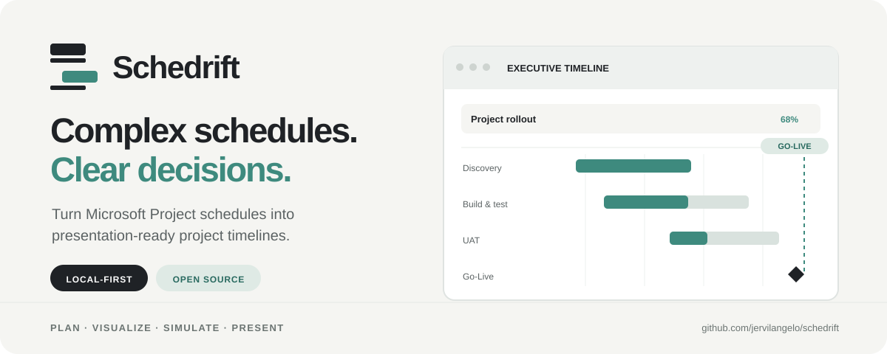

<div align="center">



<br />

**Make your Microsoft Project schedule presentable.**

Convert detailed project plans into clear, interactive Gantt charts built for stakeholder conversations.

[Explore the features](#what-schedrift-does) · [Get started](#get-started) · [See the screenshots](#see-it-in-action) · [Understand the architecture](#under-the-hood)

<br />


</div>

---

## Why Schedrift?

Microsoft Project is excellent for planning. Explaining that plan in a meeting is a different problem. Dense task grids, dependency chains and long timelines can make it hard for a stakeholder to answer a simple question:

> **If this task slips, what happens to Go-Live?**

**Schedrift bridges the gap between project planning and project communication.** Bring in a schedule, see the whole project in one presentation-ready view, and explore the downstream impact of potential delays without changing your original Microsoft Project file.

## See it in action

### 01 · The big picture — Executive view


A focused, fullscreen overview of project phases, progress, key milestones and Go-Live. The **Fit** option keeps the plan visible without scrolling; rollout waves are grouped so the story stays easy to follow.

### 02 · The details — Gantt and dependencies


Move between **Executive** and **Detailed** views. The detailed chart reveals task relationships, float, predecessors and successors; **Critical path** focus helps isolate what matters to the completion date.

### 03 · The question — What if a task slips?


Select one or more tasks, change their start or duration in working days, and watch the timeline and Go-Live variance update. See which dependent tasks move and the chain driving the change.

> Screenshots and the bundled **Atlas ERP Rollout** sample are synthetic. They contain no real customer or company schedules.

## What Schedrift does

| Capability | What you get |
| :-- | :-- |
| **Import Microsoft Project** | Load `.mpp`, `.mpx` and Microsoft Project XML (`.xml`) files. |
| **Executive & Detailed Gantt** | One-screen phase overview or a deeper look at task relationships. |
| **Critical-path analysis** | Highlight critical tasks and inspect total float. |
| **Delay simulation** | Model start and duration changes, including downstream Go-Live impact. |
| **Baseline comparison** | Compare the original schedule with scenarios and baseline outlines. |
| **Present mode** | Fullscreen view with readable typography and fewer distractions. |
| **Excel master updates** | Apply reviewed dates and status from `.xlsx` or `.csv` while keeping the imported dependencies. |
| **Save & export** | Reopen saved projects or export portable `.schedrift.json` project files. |

## Get started

### Windows — simplest option

1. Install **[Node.js 20+](https://nodejs.org/)**.
2. Clone or download this repository.
3. Double-click **`Schedrift.cmd`**.

The first launch installs Node dependencies and downloads pinned, checksum-verified runtimes into `vendor/` (approximately 80 MB): **MPXJ 16.10.0** for `.mpp` parsing and a portable **Eclipse Temurin 21** JRE if Java 11+ is not present. No administrator access is required for the bundled setup.

Schedrift opens in your browser at **http://localhost:5178**. Keep the console window open while working; close it to stop the application.

### Developers

```bash
npm ci
npm run setup
npm run build && npm start
# or: npm run dev
```

The server binds to `127.0.0.1`. Use `SCHEDRIFT_PORT` if you need another port.

### Your first schedule

1. **Import** an `.mpp`, `.mpx`, `.xml` or previously exported `.schedrift.json` file.
2. Choose **Executive** and **Fit** for a stakeholder-ready overview.
3. Select the milestone that represents **Go-Live**.
4. Select a task in **Detailed** view and try **Simulate** to explore potential delays.
5. Use **Present** to go fullscreen, or **Save / Export** to keep your scenario.

No project file handy? Explore the bundled synthetic sample at `public/samples/atlas-erp-rollout.xml`.

## Built to explain schedule changes, not rewrite your plan

Schedrift deliberately preserves the **Start** and **Finish** dates stored in your project file. It does *not* attempt to reproduce Microsoft Project's scheduling and resource-leveling engine.

- Dependencies are imported as defined in the file (FS, SS, FF and SF, including supported lags).
- A simulated delay reaches successors only when it exceeds the gap already available between tasks.
- Completed tasks cannot be delayed; in-progress tasks keep their start.
- Scenarios are separate from the original approved schedule.
- The import report flags cycles, missing predecessors, invalid dates and unsupported features.

For more on assumptions, design decisions and edge cases, see the [master blueprint](docs/SCHEDRIFT_MASTER_BLUEPRINT.md).

## Your schedule stays on your computer

**No cloud. No login. No telemetry.**

The application uses a local Node server bound to `127.0.0.1`. Original `.mpp` files are read from temporary copies and never modified. Real project files and saved `.schedrift.json` data are excluded from Git via `.gitignore`.

A one-time thank-you card after a project opens links to this GitHub repository. Dismissing it stores only a local browser flag; it does not send data anywhere.

## Under the hood

```text
React UI (src/features)
    │
    ├── zustand (src/store) ──► TypeScript scheduling engine
    │                            ├── dependency propagation
    │                            ├── total float / critical path
    │                            └── scenario impact
    │
    ├── custom SVG Gantt renderer + row virtualization
    │
    └── local Node HTTP API (127.0.0.1)
           ├── Java + MPXJ ──► MSPDI XML ──► TypeScript importer
           └── local saved projects
```

**Key engineering areas:** React, TypeScript, state management, SVG chart rendering, graph and scheduling logic, Microsoft Project interoperability, local-first architecture and automated tests.

### Testing

```bash
npm test          # Vitest unit and integration tests
npm run fixtures  # public synthetic .mpp fixtures
npm run test:e2e   # Playwright browser tests
```

The test datasets are synthetic. See [TESTING.md](docs/TESTING.md) for coverage.

## Important limitations

- **Not an MS Project replacement:** dates are displayed as stored; changes made in **Project data** do not automatically reschedule other tasks.
- **Simulation granularity:** whole working days; hours within a day are treated linearly.
- **Unsupported constructs:** split tasks, recurring calendar exceptions, alternate work weeks and inserted subprojects are not fully modeled. The import report flags them.
- **No `.mpp` writing:** save scenarios in Schedrift's project format instead.
- **Runtime setup:** automatic Java download targets Windows x64; on other systems, install Java 11+ or set `SCHEDRIFT_JAVA`.

## About the project

Schedrift grew from a practical presentation challenge: **project schedules contain the right information, but not always in the form people need to make decisions.** It focuses on the clarity of the conversation — making project progress and the impact of changes easier to communicate.

**Designed & developed by [Jervil Angelo De Leon](https://github.com/jervilangelo).** If this tool helps you, consider [starring the repository](https://github.com/jervilangelo/schedrift) to support the open-source project.

The visual identity uses the **Baseline Drift** mark: two schedule bars, with one drifting from its original baseline. See the [brand guidelines](public/branding/BRAND_GUIDELINES.md).

## License & third-party components

Schedrift is released under the [MIT License](LICENSE). It uses MPXJ (LGPL-2.1), Eclipse Temurin (GPLv2 with Classpath Exception) and IBM Plex Sans (SIL Open Font License). See [third-party notices](THIRD_PARTY_NOTICES.md).

---

<div align="center">

**Complex schedules. Clear decisions.**

[⭐ Star Schedrift](https://github.com/jervilangelo/schedrift) · [Read the blueprint](docs/SCHEDRIFT_MASTER_BLUEPRINT.md)

</div>
