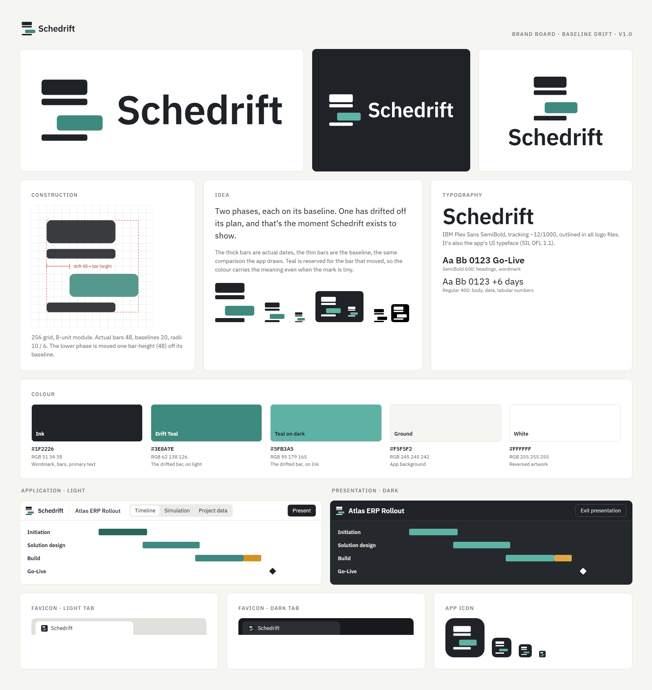

# Schedrift brand guidelines

## The mark: Baseline Drift

Two phases, each drawn as a thick bar (its actual dates) on a thin bar (its baseline). The upper phase is on plan. The lower one has drifted off its baseline by exactly one bar-height. That moment is what Schedrift exists to show.

The mark uses the app's own vocabulary: actual vs. baseline bars, with teal reserved for the bar that moved.

### Construction

- 256 × 256 grid, 8-unit module, symbol footprint 192 × 192 (32 units of clear canvas on every side).
- Actual bars: 144 × 48, radius 10. Baselines: 144 × 20, radius 6.
- Vertical rhythm: 48 · 12 · 20 · 32 · 48 · 12 · 20.
- Drift: the lower actual bar starts 48 units right of its baseline.
- **Pixel cut** (`/favicon.svg`, favicon PNGs and `.ico`): a separate drawing on a 16-px grid (1 px = 16 units) with the same idea. Rows are 2 / 1 / 2 / 1 px and the drift is 3 px, so every edge lands on a whole pixel at 16, 32 and 48 px.

## Files

| File | Use |
|---|---|
| `svg/schedrift-logo-primary.svg` | **Default.** Horizontal lockup in full colour. Switches to its dark-mode colours automatically (`prefers-color-scheme`) where the viewer supports it, and falls back to the light colours. |
| `svg/schedrift-logo-horizontal.svg` | Horizontal lockup, full colour, fixed light-background colours (documents, slides, print). |
| `svg/schedrift-logo-stacked.svg` | Stacked lockup for square or narrow spaces. |
| `svg/schedrift-logo-symbol.svg` | Symbol only (avatars, tight UI, social). |
| `svg/schedrift-logo-light.svg` | Horizontal lockup for light backgrounds (same colours as *horizontal*; named for explicit light/dark pairs). |
| `svg/schedrift-logo-dark.svg` | Horizontal lockup for dark backgrounds: white + Teal on dark. |
| `svg/schedrift-logo-black.svg` / `-white.svg` | One-colour versions (fax, engraving, single-colour print, photography). |
| `png/schedrift-logo-512.png`, `-1024.png` | Horizontal lockup, transparent, 512 × 160 and 1024 × 320. |
| `png/schedrift-icon-512.png`, `-1024.png` | App icon: symbol on an Ink tile, transparent corners. |
| `/favicon.svg`, `/favicon.ico`, `/favicon-16x16.png`, `/favicon-32x32.png`, `/favicon-48x48.png` | Browser favicons (pixel cut on an Ink tile). |
| `/apple-touch-icon.png` (180), `/android-chrome-192x192.png`, `/android-chrome-512x512.png`, `/site.webmanifest` | Home-screen and PWA icons. |
| `presentation/schedrift-brand-board.png` | Brand board: lockups, construction, palette, typography, light/dark mockups. |
| `presentation/schedrift-logo-comparison.png` | The three concepts reviewed; Baseline Drift (A) was selected. |

All SVGs are pure vector: no live text, embedded images, filters or masks. The wordmark is outlined.

## Colour

| Name | HEX | RGB | Use |
|---|---|---|---|
| Ink | `#1F2226` | 31 34 38 | Wordmark, bars, text (= `--color-ink`) |
| Drift Teal | `#3E8A7E` | 62 138 126 | The drifted bar on light backgrounds (= `--color-bar`) |
| Teal on dark | `#5FB3A5` | 95 179 165 | The drifted bar on Ink or dark backgrounds |
| Ground | `#F5F5F2` | 245 245 242 | App and board background (= `--color-ground`) |
| White | `#FFFFFF` | 255 255 255 | Reversed artwork |

Colour in the logo follows the app's rule: colour carries meaning. Only the drifted bar is teal. Do not recolour the bars in amber or red; those mean *scenario* and *late* inside the product.

## Typography

- **IBM Plex Sans** (SIL Open Font License 1.1), the same family as the UI.
- Wordmark: SemiBold 600, tracking −12/1000, set in Title case exactly as **Schedrift**.
- Headings: SemiBold 600. Body and data: Regular 400 with tabular numbers.

## Clear space and minimum size

- Clear space on every side: one **actual-bar height** (48 units at master scale, i.e. 25 % of the symbol's height).
- Horizontal lockup: minimum 96 px wide on screen / 25 mm in print.
- Symbol: minimum 16 px. Below 32 px use the pixel cut (`/favicon.svg`), not the master symbol.
- In the app header, the symbol is shown at 20 px next to live "Schedrift" text set in the same type. Below the `sm` breakpoint, when a project is open, only the symbol is shown.

## Backgrounds

- Light (white, Ground, light greys): full-colour or black artwork.
- Dark (Ink, near-black, dark photos): `-dark.svg` or `-white.svg`.
- Mid-tone or busy images: one-colour white or black, whichever has more contrast.

## Don't

- Stretch, skew, rotate or re-proportion the mark.
- Re-align the drifted bar with its baseline (that removes the idea) or change the drift distance.
- Add gradients, shadows, outlines or 3-D effects.
- Recolour the bars individually, or use amber/red for the drifted bar.
- Re-type the wordmark in another font, or change its case ("SchedRift", "SCHEDRIFT").
- Place the full-colour version on dark backgrounds, or the white version on light ones.

## Notes

- The wordmark outlines are from IBM Plex Sans (OFL), which allows use in a logo.
- A trademark search has not been done. Check before registering or using the mark commercially.
